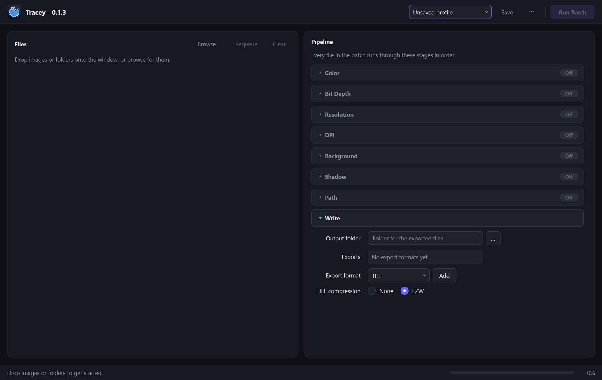

# Tracey

Batch image export with reusable processing profiles.



Drop images or folders onto the window, configure the pipeline, and run the batch.
Every file passes through the enabled stages in order:

- **Color**: convert or assign sRGB, eciRGB v2, CMYK or ISO Coated v2, with rendering intent and black point compensation
- **Bit depth**: 8-bit, 16-bit or 32-bit float
- **Resolution / DPI**: resize, and tag or resample the DPI
- **Background**: fill with a color, as a separate layer or merged
- **Shadow**: composite a shadow file, optionally as K-only ink for CMYK
- **Path**: trace the alpha channel or a mask file into a Photoshop (clipping) path
- **Write**: export to TIFF, PSD, JPEG and/or PNG

Profiles are saved to `tracey.db` in the working directory.

## Run

Requires [uv](https://docs.astral.sh/uv/) and Python 3.14.

```bash
uv run tracey
```

## Build

Builds a standalone executable into `dist/` with PyInstaller.

```bash
uv run build.py
```

## License

[MIT](LICENSE)
